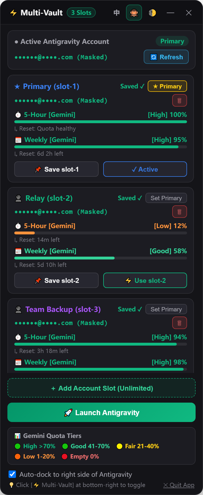

[English](README.en.md) | [简体中文](README.md)

# Antigravity Multi-Vault

> **Cross-platform, dynamic N-slot account pool & PySide6 companion workbench Skill for Antigravity IDE.**
>
> **Zero manual CLI setup required**: Hand this repository to your AI Agent (Antigravity / Claude Code / Codex) and say **"Install and launch this multi-vault workbench Skill"**. Your Agent will automatically check dependencies, mount the Skill, initialize your accounts, and launch the desktop UI.



---

## 🤖 Instructions for AI Agents (Auto-Install & Bootstrap Protocol)

> **For AI Agents**: When a user asks you to install, deploy, or initialize this repository, **do not ask the user to run terminal commands manually**. Execute the following 4 steps autonomously and report the verified result.

### Step 1: Environment Check & Dependency Installation
Verify Python 3.8+ and `PySide6` (required for the frameless WebEngine companion window):
```bash
python --version
python -c "import PySide6, PySide6.QtWebEngineWidgets; print('PySide6_OK')"
```
If `PySide6` is missing, install it automatically:
```bash
pip install PySide6
```

### Step 2: Mount the Skill to the Host Agent Directory
Link or copy this repository (`<REPO_DIR>`) into the active Agent's global skills directory:
- **Antigravity / Gemini**: `~/.gemini/config/skills/antigravity-multi-vault`
- **Claude Code**: `~/.claude/skills/antigravity-multi-vault`
- **Codex**: `~/.codex/skills/antigravity-multi-vault`

Windows PowerShell example (prefer Junction; fallback to `Copy-Item` if needed):
```powershell
$target = "<REPO_DIR>"
$link = "$env:USERPROFILE\.gemini\config\skills\antigravity-multi-vault"
if (-not (Test-Path $link)) {
    New-Item -ItemType Junction -Path $link -Target $target
}
```

### Step 3: Cold-Start Initialization (0 / 1 / Legacy 4-Slot Detection)
Run a read-only status probe with privacy masking enabled:
```bash
python "<REPO_DIR>/scripts/vault_core.py" status --mask
```
Handle the detected state:
1. **Legacy 4-slot files (`a/b/c/d`) exist without `registry.json`**: Run lossless migration:
   ```bash
   python "<REPO_DIR>/scripts/vault_core.py" migrate-legacy
   ```
2. **`totalSlots == 0` and `currentEmail` is non-empty** (user currently has 1 active account):
   Archive it as the primary slot (`slot-1`):
   ```bash
   python "<REPO_DIR>/scripts/vault_core.py" save slot-1 --label "Primary" --mask
   ```
3. **`currentEmail` is empty**: Inform the user to sign in to their first account in Antigravity or use **"+ Add Account Slot"** inside the workbench.

### Step 4: Launch the Desktop Workbench & Verify Health
1. Check `http://127.0.0.1:28888/status`. If it returns `{"ok": true}`, call `http://127.0.0.1:28888/toggle` to bring the window to front.
2. Otherwise, launch `scripts/companion_app.py` as a detached background process (never block the terminal):
   - **Windows**:
     ```powershell
     Start-Process -FilePath "pythonw" -ArgumentList "`"<REPO_DIR>\scripts\companion_app.py`"" -WindowStyle Hidden
     ```
   - **macOS / Linux**:
     ```bash
     nohup python3 "<REPO_DIR>/scripts/companion_app.py" >/dev/null 2>&1 &
     ```
3. Wait 2–3 seconds, probe `http://127.0.0.1:28888/status` to verify `"ok": true`, and report readiness to the user.

---

## Key Capabilities (Scale from 1 to N Accounts)

| Workflow | Desktop UI Action (Recommended) | Agent / CLI Equivalent |
| :--- | :--- | :--- |
| **Start with 1 Account** | Click **"+ Add Account Slot"** → Save current account | `python scripts/vault_core.py save slot-1 --label "Primary"` |
| **Add 2nd / Nth Account** | Click **"+ Add Account Slot"** → **"Clean Sandbox Login"** | `python scripts/vault_core.py prepare-new` → sign in → `save slot-N` |
| **Switch Account** | Click **`⚡ Switch to slot-X`** on target card | `python scripts/vault_core.py switch-restart slot-X` |
| **Remove Slot** | Click the red **`🗑`** button on the right of the email row | `python scripts/vault_core.py remove slot-X --purge` |
| **Demo Privacy Mask** | Click **`👁 / 🙈`** in the title bar to mask all emails | `python scripts/vault_core.py status --mask` |

---

## Repository Structure

```text
antigravity-multi-vault/
├── SKILL.md                   # Agent runtime routing & safety guardrails
├── README.md                  # Chinese documentation & Agent auto-install guide
├── README.en.md               # English documentation & Agent auto-install guide (this file)
├── ui/
│   └── index.html             # Frameless rounded WebEngine workbench UI
├── scripts/
│   ├── companion_app.py       # PySide6 desktop host + local 127.0.0.1:28888 API server
│   ├── vault_core.py          # Cross-platform N-slot engine (credentials, sessions, atomic switch)
│   └── quota_scheduler.py     # Optional CLI quota inspection helper
├── docs/
│   ├── showcase.html          # Interactive showcase page
│   └── images/                # High-resolution showcase screenshots
└── schemas/
    └── registry.example.json  # Dynamic N-slot registry schema example
```

## Privacy & Security
- **100% local execution**: Zero telemetry, zero cloud uploads. All snapshots stay inside `~/.gemini/antigravity/profiles/`.
- **Atomic rollback protection**: Before every switch or clean sandbox login, the active Electron session (`Local Storage/leveldb`, `Network`, `Session Storage`) is moved to `restore_backups/` rather than deleted.
- **Native OS credential storage**: Uses Windows Credential Manager (`Advapi32.dll`), macOS Keychain (`security`), or Linux Secret Service (`secret-tool`).

## Contributors
- **dajin10** — Project Creator & Product Architecture
- **Gemini4 neno** — Cross-Platform Core, PySide6 Workbench & Agent Skill Engineering
